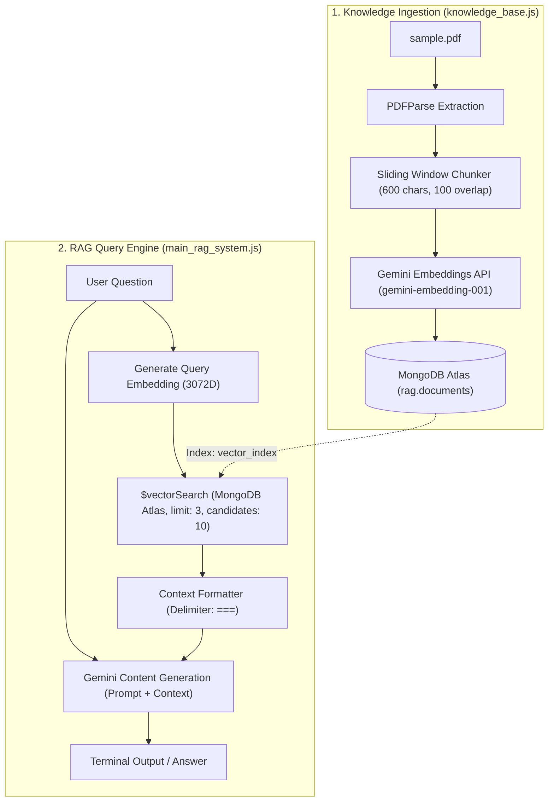

# 📚 Gemini & MongoDB Atlas Vector RAG System

<p align="center">
  
  
  
  
  
</p>

An end-to-end, production-ready **Retrieval-Augmented Generation (RAG)** CLI application built with **Node.js (ES Modules)**, **Google Gemini AI (`@google/genai`)**, and **MongoDB Atlas Vector Search**.

It enables semantic search and conversational question-answering over PDF documents with hallucination prevention and automated vector index lifecycle management.

---

## 🌟 Highlights & Key Features

- **📑 Automated Document Ingestion**: Extracts text from PDF files, cleans whitespace, and generates overlapping chunks to preserve contextual continuity across boundaries.
- **🧠 Gemini Vector Embeddings**: Uses Google's `gemini-embedding-001` model to produce high-dimensional (3072D) dense embeddings.
- **⚡ MongoDB Atlas Vector Search**: Leverages native `$vectorSearch` with cosine similarity for fast semantic retrieval.
- **🔄 Auto-Managed Vector Index**: Checks, provisions, or updates the Atlas Vector Search index dynamically on startup, waiting automatically until queryable.
- **🛡️ Hallucination Guardrails**: Prompts the LLM with strict grounding instructions to respond strictly from context or return *"I don't know"*.
- **💬 Interactive CLI Q&A Loop**: Real-time terminal interface for questioning your documents interactively.

---

## 🏗️ Architecture & Data Flow



---

## 📁 Repository Structure

```text
├── knowledge_base.js     # ETL Pipeline: Parses PDF, chunks text, generates embeddings & stores in MongoDB
├── main_rag_system.js    # RAG Engine: Manages vector index, performs similarity search & serves Q&A CLI
├── sample.pdf            # Source PDF document ingested into the knowledge base
├── package.json          # Node.js dependencies and project scripts
├── package-lock.json     # Dependency lockfile
├── .gitignore            # Protects secrets, node_modules, and OS files from version control
├── .env.example          # Safe template for required environment variables
├── .env                  # (Git-ignored) Real API keys and database connection string
└── README.md             # Project documentation
```

---

## 🛠️ Tech Stack & Dependencies

| Layer | Technology | Description |
| :--- | :--- | :--- |
| **Runtime** | [Node.js](https://nodejs.org/) (ES Modules) | Modern JavaScript runtime |
| **Generative AI** | [`@google/genai`](https://www.npmjs.com/package/@google/genai) | Official Google GenAI SDK for embeddings & text generation |
| **Database & Vector Search** | [`mongodb`](https://www.npmjs.com/package/mongodb) | Official Node.js driver with Atlas Search Vector support |
| **Document Parser** | [`pdf-parse`](https://www.npmjs.com/package/pdf-parse) | Extracts plain text from PDF files |
| **Config** | [`dotenv`](https://www.npmjs.com/package/dotenv) | Loads environment variables from `.env` |

---

## 🚀 Getting Started

### 1. Prerequisites

- **Node.js**: Version 18 or higher.
- **MongoDB Atlas Cluster**: A cluster (M0 Free Tier or higher) with Atlas Search enabled.
- **Google Gemini API Key**: Obtainable from [Google AI Studio](https://aistudio.google.com/).

---

### 2. Installation

Clone the repository and install the dependencies:

```bash
# Clone the repository
git clone <your-repo-url>
cd rag

# Install dependencies
npm install
```

---

### 3. Environment Configuration

Copy the sample environment file and fill in your credentials:

```bash
cp .env.example .env
```

Edit `.env` with your actual values:

```env
# Google Gemini API Key
Gemini_API_Key=your_gemini_api_key_here

# MongoDB Atlas Connection URI
MongoDB=mongodb+srv://<username>:<password>@<cluster-url>/?retryWrites=true&w=majority
```

> [!IMPORTANT]
> Ensure your MongoDB Atlas user has read/write permissions and your network IP access list allows connections from your current machine.

---

## 📖 How to Run

### Step 1: Ingest Document into Knowledge Base

Run the ingestion script to parse [`sample.pdf`](./sample.pdf), generate embeddings, and insert chunks into MongoDB:

```bash
node knowledge_base.js
```

**Ingestion Output Example:**
```text
Reading pdf file...
Parsed 3 pages from sample.pdf
Chunk inserted: 1 / 14 embedding length: 3072
Chunk inserted: 2 / 14 embedding length: 3072
...
Chunk inserted: 14 / 14 embedding length: 3072
```

---

### Step 2: Start the Document Q&A Bot

Launch the interactive RAG system:

```bash
node main_rag_system.js
```

Upon launching, the script will:
1. Connect to MongoDB.
2. Verify or create the `vector_index` search index.
3. Wait until the index status is `queryable`.
4. Open the interactive command-line interface.

**Interactive CLI Session Example:**
```text
Creating vector_index with 3072 dimensions...
Welcome to Document QA Bot
Ask a Question: What is the main topic of the document?

Answer:
The document discusses the core principles of Retrieval-Augmented Generation (RAG) and its integration with modern vector databases.

Ask a Question: What does the paper say about quantum computing?

Answer:
I don't know.

Ask a Question: exit
Exiting...
```

---

## 🔍 Deep Dive: How It Works

### 1. Chunking Strategy ([`knowledge_base.js`](./knowledge_base.js))
Text is normalized by condensing extraneous whitespace and processed using a fixed sliding character window:
```javascript
function createChunks(text, chunkSize = 600, overlap = 100) {
  const cleanedText = text.replace(/\s+/g, ' ').trim();
  const chunks = [];
  let start = 0;
  while (start < cleanedText.length) {
    const end = Math.min(start + chunkSize, cleanedText.length);
    chunks.push(cleanedText.slice(start, end));
    start += chunkSize - overlap;
  }
  return chunks;
}
```

### 2. MongoDB Atlas Vector Search Pipeline ([`main_rag_system.js`](./main_rag_system.js))
When a query is entered, the query embedding is retrieved and compared against document vectors using MongoDB's `$vectorSearch` aggregation stage:
```javascript
const pipeline = [
  {
    $vectorSearch: {
      index: "vector_index",
      path: "embedding",
      queryVector: qsVector,
      numCandidates: 10,
      limit: 3,
    },
  },
  {
    $project: { _id: 0, chunkText: 1 },
  },
];
```

### 3. Grounded Prompt Engineering
The system prompt injects retrieved context blocks and instructs the model:
```text
You are a helpful assistant. Use the following context to answer the question.
If the answer is not contained within the context, say "I don't know."

Context:
<retrieved_chunks>

Question: <user_question>
Answer:
```

---

## ⚙️ Configuration & Customization

You can adjust key parameters directly in the code:

| Parameter | Location | Default | Description |
| :--- | :--- | :--- | :--- |
| `chunkSize` | `knowledge_base.js:39` | `600` | Number of characters per text chunk |
| `overlap` | `knowledge_base.js:39` | `100` | Overlapping characters between consecutive chunks |
| `EMBEDDING_DIMENSIONS` | `main_rag_system.js:15` | `3072` | Embedding vector dimensionality |
| `numCandidates` | `main_rag_system.js:91` | `10` | Candidate pool size for approximate nearest neighbors (ANN) |
| `limit` | `main_rag_system.js:92` | `3` | Number of context chunks fed to the LLM |
| `model` (Generation) | `main_rag_system.js:111` | `gemini-3.6-flash` | Gemini model used for synthesis |

---

## 🐛 Troubleshooting

<details>
<summary><b>1. Vector Index Timed Out</b></summary>

* **Cause**: MongoDB Atlas can take 30–90 seconds to build a vector search index on new collections.
* **Fix**: Ensure your cluster is running on Atlas (M0+ tier) and that vector search is enabled. Rerun `node main_rag_system.js` if the initial build exceeds 60 seconds.
</details>

<details>
<summary><b>2. Invalid API Key Error</b></summary>

* **Cause**: Missing or invalid `Gemini_API_Key` in `.env`.
* **Fix**: Verify your key from [Google AI Studio](https://aistudio.google.com/) and check that the `.env` variable name matches `Gemini_API_Key`.
</details>

<details>
<summary><b>3. Dimension Mismatch Error</b></summary>

* **Cause**: Embedding model output dimension does not match `EMBEDDING_DIMENSIONS` (3072).
* **Fix**: Ensure both `knowledge_base.js` and `main_rag_system.js` use the same embedding model (`gemini-embedding-001`).
</details>

---

## 📄 License

This project is open source and available under the [MIT License](LICENSE).
